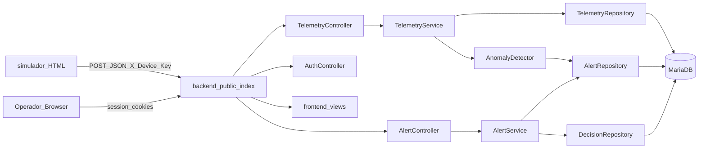

# MVP Drain Monitoring Design

**Spec**: `.specs/features/mvp-drain-monitoring/spec.md`
**Context**: `.specs/features/mvp-drain-monitoring/context.md`
**Status**: Approved (plan decisions AD-001..AD-005)

---

## Architecture Overview

Monolith-style PHP 8 OOP app: HTTP ingest API + session-based Operator SSR UI, MariaDB persistence, HTML simulator as external client. Anomaly detection runs synchronously after each successful telemetry insert (no queue in MVP).



---

## Code Reuse Analysis

### Existing Components to Leverage

| Component | Location | How to Use |
| --------- | -------- | ---------- |
| Telemetry JSON contract | `simulador-iot/simulador-v1.html` | Canonical payload; move under `simulador/` and add real `fetch` |
| Deterministic thresholds | Same file (level≥75, flow≤0.05) | Encode as constants in `AnomalyDetector` |
| Vision constraints | `docs/BioColeta.md` | PHP 8 OOP, MariaDB, human-in-the-loop |

### Integration Points

| System | Integration Method |
| ------ | ------------------ |
| MariaDB | PDO via repository classes; schema in `database/migrations/` |
| Simulador | Browser `fetch` to backend base URL + `X-Device-Key` |
| Frontend views | PHP `require` of files under `frontend/views/` |

---

## Components

### TelemetryController

- **Purpose**: Accept and validate HTTP telemetry POSTs
- **Location**: `backend/src/Http/TelemetryController.php`
- **Interfaces**:
  - `create(Request): Response` — validate key + JSON; delegate to service
- **Dependencies**: `TelemetryService`, device-key config
- **Reuses**: Payload shape from simulador contract

### TelemetryService

- **Purpose**: Persist reading and trigger detection
- **Location**: `backend/src/Service/TelemetryService.php`
- **Interfaces**:
  - `ingest(array $payload): TelemetryRecord`
- **Dependencies**: `TelemetryRepository`, `AnomalyDetector`

### AnomalyDetector

- **Purpose**: Apply consecutive-reading rule; create structured alert when matched
- **Location**: `backend/src/Domain/AnomalyDetector.php`
- **Interfaces**:
  - `evaluateAfterInsert(string $deviceId, int $telemetryId): ?Alert`
- **Dependencies**: `TelemetryRepository`, `AlertRepository`
- **Constants**: `LEVEL_MIN = 75.0`, `FLOW_MAX = 0.05`, `CONSECUTIVE = 2`, `RULE_ID = obstruction_level_flow_v1`

### AlertService / AlertController

- **Purpose**: List pending alerts (SSR); record operator decisions
- **Location**: `backend/src/Service/AlertService.php`, `backend/src/Http/AlertController.php`
- **Interfaces**:
  - `listPending(): array`
  - `decide(int $alertId, string $outcome, ?string $note, int $userId): void`

### AuthController / SessionGate

- **Purpose**: Login/logout and protect Operator routes
- **Location**: `backend/src/Http/AuthController.php`, `backend/src/Http/SessionGate.php`

### Simulador

- **Purpose**: Continuous HTTP client UI for demo
- **Location**: `simulador/simulador-v1.html`
- **Interfaces**: configurable base URL + device key; 10s interval POST

---

## Data Models

### devices (optional seed row)

| Field | Type | Notes |
| ----- | ---- | ----- |
| id | PK | |
| device_id | VARCHAR unique | e.g. ESP32-DRAIN-0102 |
| entity_id | VARCHAR | BUEIRO-0102 |
| active | BOOL | |

### telemetry

| Field | Type | Notes |
| ----- | ---- | ----- |
| id | BIGINT PK | |
| device_id | VARCHAR | indexed |
| entity_id | VARCHAR | |
| recorded_at | DATETIME(3) | from payload timestamp |
| water_level | DECIMAL | percent |
| water_flow | DECIMAL | L/s |
| quality | DECIMAL | nullable |
| tamper_alert | BOOL | |
| raw_json | JSON | full payload |
| created_at | DATETIME | server |

### alerts

| Field | Type | Notes |
| ----- | ---- | ----- |
| id | BIGINT PK | |
| device_id | VARCHAR | |
| status | ENUM pending,resolved | |
| rule_id | VARCHAR | obstruction_level_flow_v1 |
| classification_json | JSON | thresholds, reading ids, values |
| created_at | DATETIME | |
| resolved_at | DATETIME nullable | |

### decisions

| Field | Type | Notes |
| ----- | ---- | ----- |
| id | BIGINT PK | |
| alert_id | FK unique | one decision per alert MVP |
| user_id | FK | |
| outcome | ENUM confirmado,falso_positivo | |
| note | TEXT nullable | |
| created_at | DATETIME | |

### users

| Field | Type | Notes |
| ----- | ---- | ----- |
| id | PK | |
| username | VARCHAR | |
| password_hash | VARCHAR | password_hash() |
| created_at | DATETIME | |

**Structured classification example (DET-01):**

```json
{
  "rule_id": "obstruction_level_flow_v1",
  "thresholds": { "water_level_min": 75, "water_flow_max": 0.05, "consecutive": 2 },
  "telemetry_ids": [101, 102],
  "readings": [
    { "id": 101, "water_level": 85, "water_flow": 0.01 },
    { "id": 102, "water_level": 85, "water_flow": 0.01 }
  ]
}
```

---

## API Contracts

### `POST /api/telemetry`

- Headers: `Content-Type: application/json`, `X-Device-Key: <secret>`
- Body: simulador contract
- `201`: `{ "id": <telemetry_id>, "alert_id": <id|null> }`
- `400` / `401` / `503` as per spec

### Operator routes (SSR)

- `GET /login`, `POST /login`, `POST /logout`
- `GET /alerts`
- `POST /alerts/{id}/decision` — form fields `outcome`, `note`

---

## Tech Decisions (feature-local)

| Decision | Choice | Rationale |
| -------- | ------ | --------- |
| Router | Single `public/index.php` front controller | Minimal OOP PHP |
| Views | Plain PHP under `frontend/views/` | KISS (context) |
| DB access | PDO | Native, no ORM required for MVP |
| Detection timing | Sync after insert | No broker/queue in MVP |
| Config | `backend/config/*.php` + env vars for secrets | Device key, DSN, session |

Project-level constraints: see `.specs/STATE.md` AD-001..AD-005.

---

## Risks & Concerns

| Risk | Mitigation |
| ---- | ---------- |
| Simulador currently only logs (no fetch) | SIM tasks wire real POST + CORS/same-origin notes |
| Duplicate consecutive anomalous posts may re-fire rule | DET-03: dedupe by telemetry id pair in classification or unique key |
| Open ingest if device key weak | Document env secret; reject missing key (TEL-03) |
| No test harness yet | tasks.md matrix defaults to PHPUnit; confirm at Execute |
| SSR path coupling backend↔frontend dirs | Config `VIEWS_PATH` pointing at `../../frontend/views` |

---

## Soft-Delete / Retention

N/A for MVP — no soft-delete; telemetry retained for demo window without TTL job.
