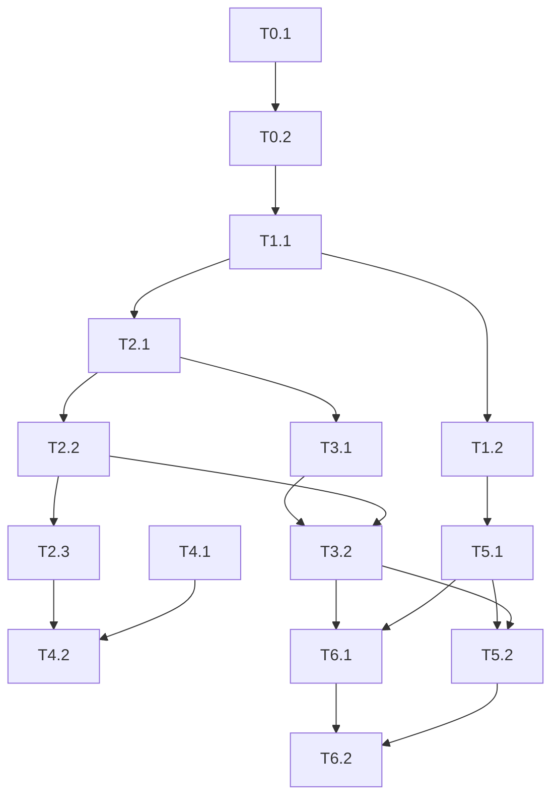

# MVP Drain Monitoring Tasks

**Spec**: `.specs/features/mvp-drain-monitoring/spec.md`
**Design**: `.specs/features/mvp-drain-monitoring/design.md`

---

## Test Coverage Matrix

> Generated from codebase, project guidelines, and spec — confirm before Execute. Guidelines found: none — strong defaults applied (greenfield).

| Code Layer | Required Test Type | Coverage Expectation | Location Pattern | Run Command |
| ---------- | ------------------ | -------------------- | ---------------- | ----------- |
| Domain (AnomalyDetector) | unit | All branches; 1:1 DET ACs + edge cases | `backend/tests/Unit/**/*Test.php` | `cd backend && ./vendor/bin/phpunit --testsuite Unit` |
| Service (Telemetry/Alert) | unit | Happy + validation/auth failure paths mapped to TEL/DEC | `backend/tests/Unit/**/*Test.php` | same |
| HTTP controllers | integration | Routes: happy + 400/401/409/503 | `backend/tests/Integration/**/*Test.php` | `cd backend && ./vendor/bin/phpunit --testsuite Integration` |
| Migrations / config | none | build/schema apply gate only | `database/migrations/` | `mysql < migration` (manual/CI later) |
| Simulador HTML | none (manual demo) | SIM-01/02 via demo checklist | `simulador/` | manual |

## Parallelism Assessment

> Generated from codebase — confirm before Execute.

| Test Type | Parallel-Safe? | Isolation Model | Evidence |
| --------- | -------------- | --------------- | -------- |
| Unit | Yes | Pure domain / mocked repos | greenfield default |
| Integration | No | Shared MariaDB or test DB | assume sequential until isolated DB per run |

## Gate Check Commands

> Generated from codebase — confirm before Execute. PHPUnit not installed until Execute Phase 0.

| Gate Level | When to Use | Command |
| ---------- | ----------- | ------- |
| Quick | After unit-only tasks | `cd backend && ./vendor/bin/phpunit --testsuite Unit` |
| Full | After HTTP/integration tasks | `cd backend && ./vendor/bin/phpunit` |
| Build | Phase completion | schema apply + Full + manual SIM smoke |

---

## Phase 0: Scaffold & tooling

### T0.1 — Composer + PHPUnit bootstrap

- **Emit**: `backend/composer.json`, `phpunit.xml`, autoload PSR-4
- **Verify**: `composer install` succeeds
- **Gate**: Build (composer)
- **Commit**: `chore: bootstrap PHP backend with PHPUnit`

### T0.2 — Config skeleton (DSN, device key, views path)

- **Emit**: `backend/config/app.php`, `.env.example`
- **Verify**: config loads without DB
- **Commit**: `chore: add backend config skeleton`

---

## Phase 1: Database

### T1.1 — Migration: users, devices, telemetry, alerts, decisions

- **Emit**: `database/migrations/001_init.sql`
- **Requires**: T0.2
- **Verify**: SQL applies cleanly on empty MariaDB
- **Maps**: foundation for TEL/DET/ALT/DEC
- **Commit**: `feat(db): initial MariaDB schema for MVP`

### T1.2 — Seed operator user + demo device

- **Emit**: `database/migrations/002_seed_demo.sql`
- **Requires**: T1.1
- **Verify**: selectable user + device rows
- **Commit**: `feat(db): seed demo operator and device`

---

## Phase 2: Telemetry ingest (TEL)

### T2.1 — TelemetryRepository::insert

- **Emit**: `backend/src/Repository/TelemetryRepository.php`
- **Requires**: T1.1
- **Verify**: unit/integration insert round-trip
- **Maps**: TEL-01
- **Commit**: `feat(tel): persist telemetry rows`

### T2.2 — TelemetryService::ingest + payload validation

- **Emit**: `backend/src/Service/TelemetryService.php`, validator helper
- **Requires**: T2.1
- **Verify**: valid payload OK; missing fields rejected
- **Maps**: TEL-01, TEL-02
- **Commit**: `feat(tel): validate and ingest telemetry payload`

### T2.3 — Device key gate + TelemetryController POST

- **Emit**: `backend/src/Http/TelemetryController.php`, router wiring
- **Requires**: T2.2, T0.2
- **Verify**: 201 / 400 / 401 via integration tests
- **Maps**: TEL-01, TEL-02, TEL-03
- **Commit**: `feat(tel): HTTP POST /api/telemetry with device key`

---

## Phase 3: Deterministic detection (DET)

### T3.1 — AnomalyDetector consecutive rule

- **Emit**: `backend/src/Domain/AnomalyDetector.php`
- **Requires**: T2.1
- **Verify**: unit tests — 0/1/2 anomalous readings; high level only; dedupe pair
- **Maps**: DET-01, DET-02, DET-03 + edge cases
- **Commit**: `feat(det): deterministic obstruction rule on consecutive readings`

### T3.2 — AlertRepository create + wire detector after ingest

- **Emit**: `backend/src/Repository/AlertRepository.php`; update TelemetryService
- **Requires**: T3.1, T2.2
- **Verify**: two anomalous POSTs → one pending alert with classification_json
- **Maps**: DET-01, DET-03
- **Commit**: `feat(det): create structured alerts after telemetry ingest`

---

## Phase 4: Simulator (SIM)

### T4.1 — Move simulador to `simulador/` and add configurable base URL + device key

- **Emit**: `simulador/simulador-v1.html` (from `simulador-iot/`); remove old path
- **Requires**: none (can parallel after T2.3 for live test)
- **Verify**: UI fields for URL/key present
- **Maps**: SIM-01
- **Commit**: `refactor(sim): relocate simulator under simulador/`

### T4.2 — Real `fetch` POST every 10s + obstruction scenario

- **Emit**: update simulador JS
- **Requires**: T4.1, T2.3
- **Verify**: network POSTs; obstruction sets level/flow to rule thresholds
- **Maps**: SIM-01, SIM-02
- **Commit**: `feat(sim): continuous HTTP telemetry and obstruction scenario`

---

## Phase 5: Operator panel (ALT)

### T5.1 — Session auth login/logout

- **Emit**: AuthController, login view, SessionGate
- **Requires**: T1.2
- **Verify**: bad password rejected; good password sets session
- **Maps**: ALT-03
- **Commit**: `feat(auth): operator session login`

### T5.2 — Alerts list SSR page

- **Emit**: AlertController list, `frontend/views/alerts.php`, assets
- **Requires**: T5.1, T3.2
- **Verify**: pending alerts listed; empty state; unauthenticated redirect
- **Maps**: ALT-01, ALT-02, ALT-03
- **Commit**: `feat(alt): operator alerts panel`

---

## Phase 6: Decision record (DEC)

### T6.1 — DecisionRepository + AlertService::decide

- **Emit**: repositories/service methods
- **Requires**: T3.2, T5.1
- **Verify**: pending → resolved; second decide → conflict
- **Maps**: DEC-01, DEC-02
- **Commit**: `feat(dec): persist operator decisions on alerts`

### T6.2 — Decision form on alerts UI

- **Emit**: form POST `/alerts/{id}/decision`
- **Requires**: T6.1, T5.2
- **Verify**: UI resolves alert; audit fields visible or in DB
- **Maps**: DEC-01, DEC-02
- **Commit**: `feat(dec): operator decision form on alert panel`

---

## Dependency graph

**Suggested order**: T0 → T1 → T2 → T3 → T4 → T5 → T6

---

## Requirement mapping

| Requirement ID | Tasks |
| -------------- | ----- |
| TEL-01 | T2.1, T2.2, T2.3 |
| TEL-02 | T2.2, T2.3 |
| TEL-03 | T2.3 |
| DET-01 | T3.1, T3.2 |
| DET-02 | T3.1 |
| DET-03 | T3.1, T3.2 |
| ALT-01 | T5.2 |
| ALT-02 | T5.2 |
| ALT-03 | T5.1, T5.2 |
| DEC-01 | T6.1, T6.2 |
| DEC-02 | T6.1, T6.2 |
| SIM-01 | T4.1, T4.2 |
| SIM-02 | T4.2 |

**Coverage:** 13 total, 13 mapped, 0 unmapped

---

## Parallel execution notes

- After T2.3: T4.1 can start in parallel with T3.*
- T5.1 can start after T1.2 in parallel with T2/T3
- Do not parallelize T3.2 with unfinished T2.2
